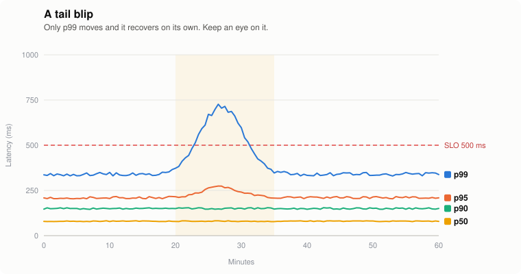
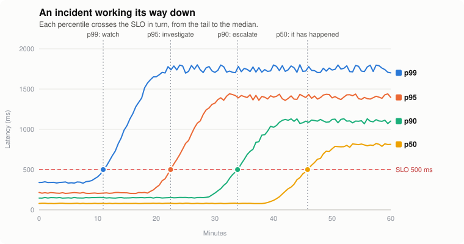
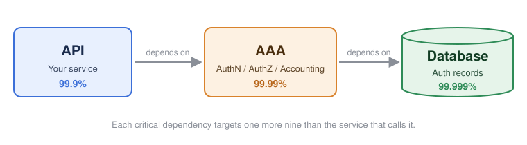

> [!TIP]
> Want the short version? Get the one-pager [cheat sheet (PDF)](cheat-sheet.pdf).

Setting clear expectations for your service helps you:

- tell your customers what to expect from the service;
- find issues before your customers do; and
- give your on-call smooth, mechanical procedures to diagnose, triage, and fix outages or degraded service.

## SLIs (Service Level Indicators)

Before getting to objectives, you need to decide which indicators to monitor. Everything else in this post builds on them. The two most common are:

- **Availability**: The service can be reached and returns successful responses.
- **Latency**: How long responses take to reach the customer.

You can cut these into finer grained dimensions like:

- **Customers &amp; System Clients**: Different clients may need different objectives and responses.
- **Response Types**: Error classes like HTTP response codes (e.g. auth, internal, throttling).
- **Version Rollout**: Correlates issues with a rollout.
- **Serving Metrics**: Resource allocation and starvation.

### Client Errors Can Be Your Errors

It's tempting to write off 4xx responses as the customer's problem. That changes if you also ship the client library. A bug in the library, or an old version that doesn't match an updated API, shows up as client errors even though the fault is yours. If you provide the client, monitor client errors as an SLI and cut them by library version (e.g. from the user agent) so you can tell a bad release apart from one misbehaving customer. The playbook example further down is exactly this case.

### Canary in the Coal Mine

[Coal miners used canaries](https://en.wikipedia.org/wiki/Sentinel_species) to detect deadly gases underground. Your SLIs work the same way.

Percentiles are the usual way to watch a metric's trend, typically the 50th, 90th, 95th, and 99th. Here is what I have usually seen when each one degrades:

- **p99**: May not be an issue yet, but watch for further degradation.
- **p95**: A larger event is likely coming. Start an investigation.
- **p90**: It is very likely happening and needs a larger response.
- **p50**: It has happened.

For example, below is a tail blip against a latency SLO (see SLOs below). Only p99 crosses the SLO and it recovers on its own. It isn't worth paging anyone over, but if it keeps happening it's worth a ticket.

Compare that to an incident working its way down from the tail to the median. Each crossing should ratchet up your response.

## SLOs (Service Level Objectives)

This is the most important piece of your production stance. It defines what you expect from your service in terms of your indicators, most commonly **availability** and **latency**. If you have a customer agreement in place (see SLAs), your SLOs should be tighter than it. That gives you time to respond to incidents before breaking the agreement, which can mean lost revenue and contractual penalties.

### Rule of Extra 9's

This comes from the ACM paper ["The Calculus of Service Availability" (Beyer, Murphy, Rensin, et al.)](https://queue.acm.org/doi/10.1145/3084693.3096459). Each critical dependency should provide one more nine of availability than the service that depends on it. If your service targets 99.9%, its critical dependencies should target 99.99%.

> [!NOTE]
> This isn't a hard rule. It depends on how many dependencies you have and how much availability they can realistically provide. Sometimes an extra 5 is enough (e.g. 99.95% instead of 99.99%). It comes down to your risk analysis and how the systems behave in production.

## SLAs (Service Level Agreements)

This is the promise you make to your customers, usually in a contract. SLOs are internal targets, but an SLA has teeth. Miss it and you face service credits, refunds, or a customer with the right to walk away.

Since it's a contract, sales, legal, and finance get involved too. Make sure engineering is part of that conversation, or you can end up with a promise your service was never built to keep.

Not every service needs one. Internal services usually just need SLOs that their callers can plan around.

### Keep It Looser Than Your SLO

Your SLA should always be looser than your SLO. The gap is your buffer to catch and mitigate an incident before it costs you money. For example, over a 30-day window:

- **SLO**: 99.95% availability, which is a budget of $\qty{21.6}{min}$.
- **SLA**: 99.9% availability, which is a budget of $\qty{43.2}{min}$.

A complete outage breaches the SLO after $\qty{21.6}{min}$, leaving another $\qty{21.6}{min}$ before you breach the SLA. That's the time on-call has to stop the bleeding (see Burn Rate).

### Define Everything

An SLA is only as good as its definitions. Vague wording turns every incident into an argument over whether the agreement was broken. Spell out:

- **What is measured**: Which indicators and where they are measured from (e.g. server-side success rate, not the customer's own network).
- **What counts as a failure**: For example, 5xx responses count against you but 4xx don't. Keep watching 4xx internally anyway if you ship the client library (see Client Errors Can Be Your Errors).
- **Measurement window**: Calendar month, rolling 30 days, per region, per customer.
- **Exclusions**: Scheduled maintenance, customer-caused issues, preview features, etc.
- **Remedies**: What the customer gets and how they claim it.

### Service Credits

Most SLAs pay out service credits on a tiered scale. Here is a made-up example:

| Monthly availability | Credit |
| -------------------- | ------ |
| Below 99.9%          | 10%    |
| Below 99.0%          | 25%    |
| Below 95.0%          | 100%   |

Credits are usually capped at the customer's bill and have to be requested. Don't let that make you comfortable. The bigger cost is lost trust, which doesn't show up on an invoice. See the [Google Compute Engine SLA](https://cloud.google.com/compute/sla) for a real example.

### Don't Promise What Your Dependencies Can't Deliver

Your SLA can't be better than what your critical dependencies give you (see Rule of Extra 9's). If a dependency only commits to 99.9%, promising your customers 99.99% on top of it is a terrible idea. Check the agreements underneath you and design around them (e.g. multiple zones or regions) before you sign anything.

## Monitoring &amp; On-call

### Key Considerations

Ask yourself how you manage risk and customer and stakeholder confidence:

- Do you have one umbrella SLO across all customers or one per customer?
- How do you bucket SLOs by customer or customer group (e.g. subscription tiers)?
- What happens if you violate an SLO or SLA (e.g. lost revenue, legal action, customer churn)?
- How much margin should your internal SLO have over the published one?

### Burn Rate

Burn rate tells you how severe an incident is and how fast you need to respond. A slow burn that would violate the SLO in a couple of days is a ticket. A fast burn could demand resolution in minutes or hours.

Map each burn rate to a response:

- open a ticket;
- page tier-2 on-call; or
- page tier-1 on-call.

The formulas for your time budget are:

$$
\begin{aligned}
\text{days} \times \text{hours} \times \text{minutes} &= \text{total time} \\
\text{total time} \times (1 - 0.\text{nines}) &= \text{time budget} \\
\text{time budget} \div \text{error rate} &= \text{time to exhaust budget}
\end{aligned}
$$

#### Example

Let's take a 99.9% (0.999) availability SLO over a 30-day window. That breaks down to:

$$ \text{days} \times \text{hours} \times \text{minutes} = \text{total time} \to 30 \times 24 \times 60 = \qty{43{,}200}{min} $$

Why minutes? Human response time and automated mitigation (e.g. rollbacks, draining, re-routing) both work on the scale of minutes.

Your time budget over the 30-day window is:

$$ \text{total time} \times (1 - 0.\text{nines}) = \text{time budget} \to 43{,}200 \times (1 - 0.999) = \qty{43.2}{min} $$

Now you can measure an incident by its rate of burn:

- a complete outage (100% of traffic) exhausts the budget in $\qty{43.2}{min}$, which usually means a tier-1 page;
- a 50% outage exhausts it in $\qty{43.2}{min} / 0.50 = \qty{86.4}{min}$, which usually gets the same response;
- a 1% outage exhausts it in $\qty{43.2}{min} / 0.01 = \qty{4{,}320}{min} = \qty{3}{days}$, which could be a tier-2 page; and
- a 0.5% outage exhausts it in $\qty{43.2}{min} / 0.005 = \qty{8{,}640}{min} = \qty{6}{days}$, which could be a ticket.

This helps you decide how much effort to put into an issue and how quickly.

### Don't fix it live, mitigate it!

**Unless the fix is trivial, working on it live just keeps the incident burning.** Mitigation lowers the burn rate or resolves the incident outright. This comes from my own experience with production incidents. Some examples:

- **roll it back**, since bad releases are a common cause;
- **expand capacity** when resources are exhausted;
- **re-route traffic** to failovers during zone and region outages; or
- **isolate problem traffic** based on the shape of the issue (e.g. specific customers, request types).

These aren't exhaustive. What works depends on your infrastructure and the incidents you have seen before.

### Playbooks &amp; Scripts

**Responses should be procedural, not investigative.**

Relearning the code and infrastructure in the middle of an incident wastes time. Playbooks and scripts address this. Many incidents just need a known sequence of steps that reliably mitigates or resolves them.

One way to organize playbooks is by **system / service / problem title**, but it depends on how you manage your documentation (e.g. linked documents, Markdown files in a repo).

A suggested format for a playbook:

- **Service**: The affected API.
- **Owner**: The team that maintains it.
- **Title**: A short identifier for the problem.
- **Trigger**: The monitoring rule that fired the alert.
- **Description**: A high level summary to get the responder up to speed.
- **Escalation**: Who to notify (e.g. owning teams, stakeholders, communication channels).
- **Troubleshooting Steps**: A procedural way to diagnose and fix the issue.

If your alerts send notifications, link the playbook directly from them.

#### Example

Let's say your service provides market quotes to financial companies and availability starts degrading.

> [!NOTE]
> `...` is a placeholder for more text so this example isn't too verbose.

**Service**: Delayed Quotes (https://api.example.com/quotes) 
**Owner**: Quotes Service Team (`quotes-team@example.com`) 
**Title**: 400 Bad Request on ETF calls. 
**Trigger**: `api_quotes_etf_400`

**Description**

Customers can download client libraries for the API, which has strict constraints on request values. Out of date libraries, library bugs, and updated API signatures are common causes.

**Escalation**

- Email `quote-sales@example.com` to handle communication with affected customers.
- Page the Quotes Service Team and assign them as incident lead (`quotes-team-pager`).

**Troubleshooting Steps**

- Open https://dash.example.com/quotes?groupby=response to break the graph down by response type.
- If other request types are affected, click on ...
- Otherwise check which user agents are affected.
- Run `analyze_user_agent_stats.sh GET https://api.example.com/quotes 400,200 > /tmp/user_agent_stats.txt`
- Output `all user agents`
  - Run `rollback.sh api-release quotes` and monitor.
  - If errors don't change go to ...
- Output `marketdata-lib-v<ver>`
  - Email `quote-sales@example.com` to ask customers to downgrade.
  - ...

### Post-mortem (PM)

**Don't just put out the fire, learn from it.**

A clear, consistent structure for every post-mortem helps everyone involved. Include:

- Incident title.
- Affected service(s).
- Link to the incident ticket or document.
- High level summary.
- Root cause analysis (RCA).
- Timeline from the actual start to resolution.
- Action items. This is the most important part and shouldn't be limited to technical fixes.

See the [Google SRE Book: Example Postmortem](https://sre.google/sre-book/example-postmortem/) for an example, and Further Reading below for more depth.

### Don't blame people! Create an opportunity to analyze and learn.

This is so important in my experience, and the Google SRE Book covers it well (see Further Reading).

I have seen companies that don't practice this and it leads to:

- people hiding mistakes that could get them in trouble;
- employees getting fired;
- a culture of blame games; and
- post-mortems that don't prevent future incidents.

It's a sad and frustrating thing to see. Production quality stagnates, problems repeat, and people fear that issues will hurt them professionally. A blameless culture looks at the systems, procedures, and organization instead. That opens the door to honest discussion about how to improve and lets people work together to understand and solve problems.

If you hold a lead or managerial role and don't already do this, I really encourage you to stand for it. It only helps you, and it gives your reports room to be open and do what they do best.

## Conclusion

That was a lot to cover but here is the short version:

- **SLIs** - pick indicators that reflect what your customers actually experience and watch the tail percentiles for early warnings.
- **SLOs** - set internal objectives tighter than anything you promise and give critical dependencies an extra nine.
- **SLAs** - keep them looser than your SLOs, define every term, and don't promise more than your dependencies can deliver.
- **On-call** - let burn rate drive the response, mitigate before you fix, and lean on playbooks so responses are procedural.
- **Post-mortems** - learn from every incident and keep them blameless.

None of this has to be perfect on day one. Start with a couple of indicators and a reasonable SLO, then tighten things up as you learn how your service behaves in production. Good luck!

## Further Reading

- [Google SRE Book: Service Level Objectives](https://sre.google/sre-book/service-level-objectives/) - SLIs, SLOs, and SLAs from the team that popularized them.
- [Google SRE Workbook: Implementing SLOs](https://sre.google/workbook/implementing-slos/) - a practical walkthrough of choosing and rolling out SLOs.
- [Google SRE Workbook: Alerting on SLOs](https://sre.google/workbook/alerting-on-slos/) - burn rate alerting in much more depth, including multi-window alerts.
- ["The Calculus of Service Availability" (Beyer, Murphy, Rensin, et al.)](https://queue.acm.org/doi/10.1145/3084693.3096459) - the paper behind the Rule of Extra 9's.
- [Implementing Service Level Objectives (Alex Hidalgo)](https://www.oreilly.com/library/view/implementing-service-level/9781492076803/) - a book-length treatment of SLO culture and practice.
- [Google SRE Book: Postmortem Culture: Learning from Failure](https://sre.google/sre-book/postmortem-culture/) - why blameless post-mortems matter and how to run them.
- [incident.io: SRE incident post-mortem best practices](https://incident.io/blog/sre-incident-postmortem-best-practices) - templates, process, and building a learning culture.
